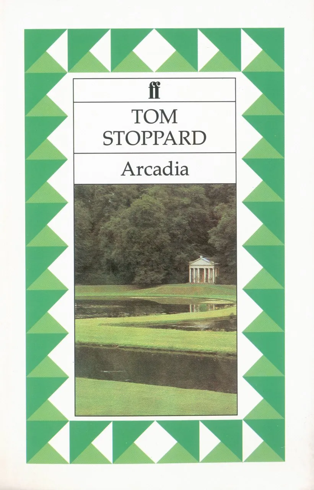
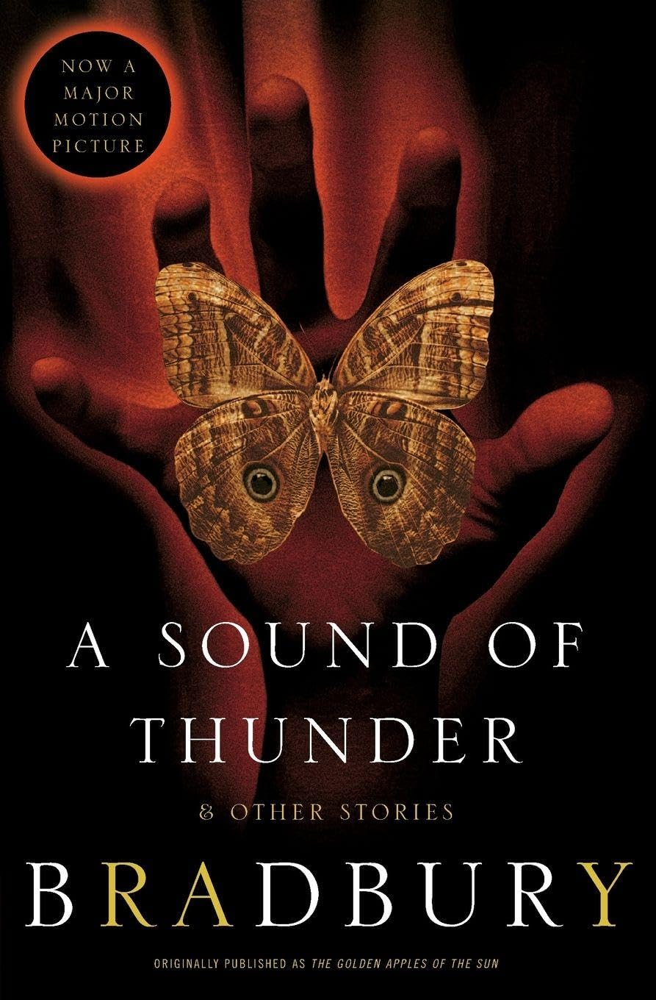
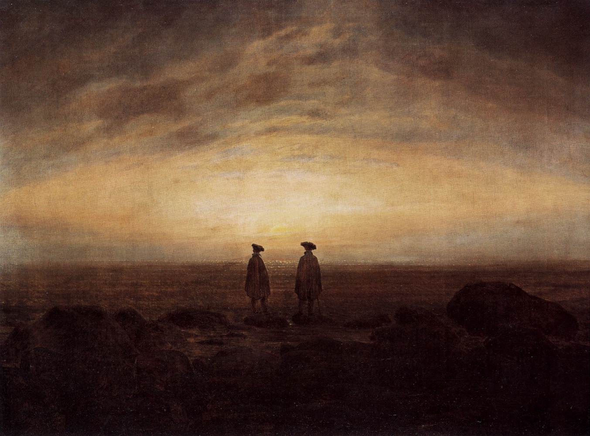
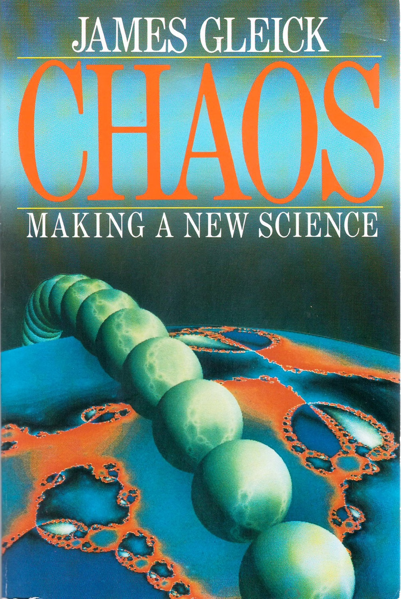
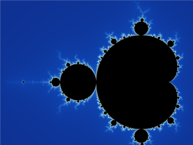
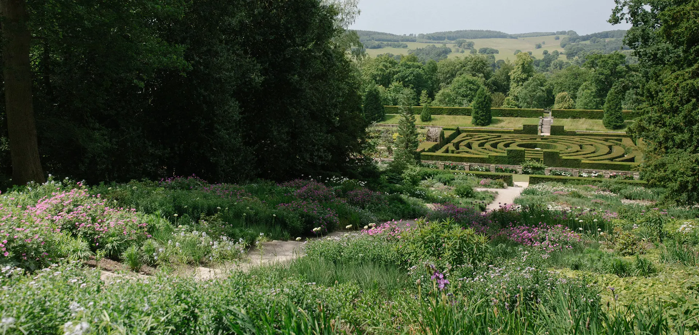

#### Tom Stoppard's Arcadia is fantastic. What can you read afterwards?
 

Tom Stoppard died in November of last year, and the reverberations are still echoing. Out of respect to one of the giants of post-war British theatre, the Duke of York's theatre in the West End permanently renamed itself in his honour. This was announced at the opening night of their staging of his 1993 play *Arcadia* earlier this year: it was a transfer from the Old Vic, with Stoppard having died just before rehearsals started. I caught the production myself earlier this year. It was, as the reviews will confirm, excellent. What did I enjoy so much about it? 

For those unfamiliar, it jumps between two narratives, separated in time but not in space. One of them is set in 1809 centred around the life and education of the precocious Thomasina Coverly, a teenage mathematician making prescient strides in mathematical model in the frustrating absence of computational resources: she is loosely based on Ada Lovelace, the daughter of Lord Byron who wrote the world's first computer programmes, albeit in the absence of a computer to run them. Thomasina is joined by her tutor Septimus Hodge and her amusingly chaotic family, with the looming off-stage presence of Lord Byron in their social circle. The second cast comprises modern day academics occupying the same country house: one of them, Valentine, is a mathematical biology postgrad working on analogous problems to Thomasina, and two others, Bernard and Hannah, are humanities researchers interested in reconstructing the 1809 events that we see played before us. Bernard in particular has a specific, speculative hypothesis he would like to confirm concerning Lord Byron. The play has a clever, but not dominant, meta-theatrical device of props being shared and moved between the two narratives: the boundaries between them eventually dissolve as the plays works its way towards its tragic ending.

<figure>
  
  <figcaption>The Faber and Faber edition of the play, featuring the landscaped gardens of the play.</figcaption>
</figure>

What strikes me about it as being particularly exciting is the play's ability to seamlessly combine scientific and humanities concepts while also being really quite funny. The physics concepts it draws on are mostly from classical Victorian-era thermodynamics and the then-new ideas of chaos theory, which broke into popular consciousness in the 1980s: both fields formalise the nature of randomness in fundamentally non-random (a.k.a deterministic) systems. 

Thermodynamics helps us to understand how a large number of small units acting predictably can be seen as being acting randomly *en masse*, which then leads us to be able to make predictive statements about their collective behaviour: think about all the atoms a gas or liquid all acting like perfectly predictable snooker balls bouncing off one another individually, but their collectively averaged behaviour producing the familiar substance we perceive as air or water. Deterministic (i.e., non-random) behaviour at the smallest, microscopic scales becomes effectively random behaviour when viewed collectively, which enables predictability at the larger, macroscopic scale.

Chaos theory, by contrast, considers deceptively simple systems following deterministic rules, that nevertheless exhibit unpredictable dynamics: small changes in the initial conditions of these systems become arbitrarily large as the clock is wound forward. One early example comes from weather forecasting: the weather is surprisingly hard to predict even though our models for the systems involved are quite mature, as seemingly insignificant differences in initial conditions become arbitrarily large as we wind the predictive clock forward.

The cliché example of the butterfly flapping its wings to generate a hurricane on the other side of the planet is one of those rare popular scientific metaphors that is both memorable and reasonably illuminating. Interestingly, while Edward Lorenz introduced the specific metaphor in a 1972 scientific article, he took the idea of the innocuously influential butterfly from Ray Bradbury's 1952 "A Sound of Thunder", in which a dead butterfly is the damning evidence that a time-traveller has irresponsibly altered history.

<figure>
  
  <figcaption>Unfortunately, by all accounts the 2005 film adaptation is lousy. The Butterfly Effect (2004), and the 1980 adaptation of Ursula K. Le Guin's The Lathe of Heaven explore similar territory to much better effect. </figcaption>
</figure>

The play has fun with both thermodynamics and chaos theory, allowing the characters to reflect out loud on the philosophical implication for their lives. At times, the tension between the scientifically and artistically inclined characters is palpable. Between Thomasina and her tutor Septimus:

> Thomasina   When you stir your rice pudding, Septimus, the spoonful of jam spreads itself round making red trails like the picture of a meteor in my astronomical atlas. But if you stir backward, the jam will not come together again. Indeed, the pudding does not notice and continues to turn pink just as before. Do you think this is odd?
> Septimus   No.
> Thomasina   Well, I do. You cannot stir things apart.
> Septimus   No more you can, time must needs run backward, and since it will not, we must stir our way onward mixing as we go, disorder out of disorder into disorder until pink is complete, unchanging and unchangeable, and we are done with it for ever. This is known as free will or self-determination.

Septimus says he does not think it is odd: does he not understand, or is he simply uninterested? He eventually gains momentum in the conversation and takes the opportunity for a rhetorical flourish to hide his unfamiliarity with the material. 

A similar exchange occurs later (in real-time, and in the play's internal chronology) between the modern-day scientist Valentine and the non-plussed humanities academic Hannah:

> Valentine   I’m telling you something. Your tea gets cold by itself, it doesn’t get hot by itself. Do you think that’s odd?
> Hannah   No.
> Valentine   Well, it is odd. Heat goes to cold. It’s a one-way street. Your tea will end up at room temperature. What’s happening to your tea is happening to everything everywhere. The sun and the stars. It’ll take a while but we’re all going to end up at room temperature.

She eventually responds in her own kind by quoting Byron's curiously astrophysical example of post-apocalyptic poetry, *Darkness*:

> I had a dream which was not all a dream.
> The bright sun was extinguished, and the stars
> Did wander darkling in the eternal space
> Rayless, and pathless, and the icy earth
> Swung blind and blackening in the moonless air

She is essentially describing through her own artistic means the same room temperature, maximum entropy end-state to which we are all collectively headed. Byron's poem was written in 1816 during the "Year without a Summer": Mount Tambora in modern-day Indonesia had erupted the previous year, causing far-reaching climate anomalies and social unrest.
<figure>
  
  <figcaption> Caspar David Friedrich's 1817 "Two Men by the Sea".</figcaption>
</figure>
By contrast, there is active hostility to be felt between Valentine and the more egotistical literature lecturer Bernard:

> Valentine   Actually, Bernard, as a scientist, your theory is incomplete.
> Bernard   But I’m not a scientist.
> Valentine   (patiently) No, *as a scientist* –

Valentine's authority in the exchange exists independently of Bernard neither caring nor understanding, which Bernard clearly resents. Bernard later eloquently expresses his scorn for the scientific attitude that neglects the personal:

> Bernard  A great poet is always timely. A great philosopher is an urgent need. There’s no rush for Isaac Newton. We were quite happy with Aristotle’s cosmos. Personally, I preferred it. Fifty-five crystal spheres geared to God’s crankshaft is my idea of a satisfying universe. I can’t think of anything more trivial than the speed of light. Quarks, quasars – big bangs, black holes – who gives a shit? How did you people con us out of all that status? All that money? And why are you so pleased with yourselves? ... If knowledge isn’t self-knowledge it isn’t doing much, mate. Is the universe expanding? Is it contracting? Is it standing on one leg and singing ‘When Father Painted the Parlour’? Leave me out. I can expand my universe without you.

The scorn that the actor Oliver Chris heaved into his delivery of "quarks" would have made Joyce proud, with Bernard, in spite of his evident self-centredness, gaining the upper hand through having more advanced rhetorical skills than his introverted rival.

The structure of the play itself is clear evidence of the personal applicability of the scientific concepts that are also being explored: the crucial tiny details of yesteryear are washed out by the inevitable entropic forward march of time, while the modern-day characters are tortured by the seemingly tiny decisions from the previous era having unpredictably huge implications in the modern day:

> Thomasina   If you could stop every atom in its position and direction, and if your mind could comprehend all the actions thus suspended, then if you were really, really good at algebra you could write the formula for all the future; and although nobody can be so clever as to do it, the formula must exist just as if one could.

The frustration articulated by Thomasina on the physical level thus becomes the defining tension of the play on a personal level. Chaos theory manifests as chaos practice.

Furthermore, the play draws an elegant metaphor between the "new science" of chaos and the development of Romanticism as a cultural movement in response to classicism. The world has disappeared in which nature is knowable to the mind of humanity, to be replaced with one in which we accept our humility in the face of the provably unpredictable wildness of reality. That encapsulates what I found so impressive about Arcadia: it manages to interweave the scientific and artistic attitudes without condescending to either camp, and having lots of fun with it along the way.

I know of no other work that achieves this goal quite so effortlessly as *Arcadia*, although it is possible that no other writers have directed their energies toward this specific goal in particular. With that in mind, I would like to highlight a few works that have at least adjacent ambitions, and would intrigue anyone whose interests have been stimulated.
<figure>
  
  <figcaption> Gleick's 1987 début book.</figcaption>
</figure>
The first work to reference would be one that inspired Stoppard himself, a 1987 non-fiction work called *Chaos: Making a New Science* by James Gleick. This was the work that broke the news of chaos theory to the general public, and represents a curious, non-fiction mirror image of *Arcadia*: a work of science communication that engages both scientific and artistic readers without compromising on accuracy. So much of "popular" science writing can be frustrating to read for a scientifically-literature person who craves the clarifying technical details that have been omitted, but also equally frustrating for a non-technical, well-educated reader with an acute sense of when they are being talked down to.

*Chaos: Making a New Science* is also impressive in its thoroughness: original interviews were performed with the scientists involved, and Gleick has taken the time to both understand their scientific contributions and provide a non-trivial insight into their personalities. The foul-mouthed Aussie behind the venerable title of Baron May of Oxford was an amusing revelation to me, and Benoit Mandelbrot's outsider status among mathematicians made more sense in the light of his neurospicy-sounding personality. Mandelbrot and fractals make up a substantial proportion of the book, which is reasonable considering the fundamental connections between chaos theory and fractal geometry, and also the latter's ability to provide photogenic illustrations for the book.

<figure>
  
  <figcaption> Valentine describes the self-similarity of the renamed Mandelbrot/Coverly set eloquently: "In an ocean of ashes, islands of order. Patterns making themselves out of nothing. I can’t show you how deep it goes. Each picture is a detail of the previous one, blown up. And so on."</figcaption>
</figure>

It is implied in *Arcadia* that Thomasina discovered the famous Mandelbrot set ahead of time, and simply didn't have the latter-day computational power available to Mandelbrot or Valentine. The process of creating the renamed "Coverly set" is described by Valentin explicitly, who appears divided about the work of his predecessor, both infuriated and humbled at Thomasina's  brilliance:

> Valentine   The maths isn’t difficult. It’s what you did at school. You have some x-and-y equation. Any value for x gives you a value for y. So you put a dot where it’s right for both x and y. Then you take the next value for x which gives you another value for y, and when you’ve done that a few times you join up the dots and that’s your graph of whatever the equation is.
> Hannah   And is that what she’s doing?
> Valentine   No. Not exactly. Not at all. What she’s doing is, every time she works out a value for y, she’s using that as her next value for x. And so on. Like a feedback. She’s feeding the solution back into the equation, and then solving it again. Iteration, you see.
> ...
> Hannah   Well done!
> Valentine   Not me. It’s Thomasina’s. I just pushed her equations through the computer a few million times further than she managed to do with her pencil.

The biography of chaos theory presented in *Chaos: Making a New Science* captures the historical transition from mathematicians scorning the use of computer-driven research, to reluctantly accepting that the systems that interest them are so inherently unstable that traditional theoretical methods are inadequate. Valentine is separated from Thomasina by this methodological watershed, and the privilege of his situation weighs heavily on him. 

Gleick's book even contains a reference to landscape architecture, a theme explored in *Arcadia*:

> Appreciating the harmonious structure of any architecture is one thing; admiring the wildness of nature is quite another. In terms of aesthetic values, the new mathematics of fractal geometry brought hard science in tune with the peculiarly modern feeling for untamed, uncivilized, undomesticated nature. At one time rain forests, deserts, bush, and badlands represented all that society was striving to subdue. If people wanted aesthetic satisfaction from vegetation, they looked at gardens. As John Fowles put it, writing of eighteenth-century England: “The period had no sympathy with unregulated or primordial nature. It was aggressive wilderness, an ugly and all-invasive reminder of the Fall, of man’s eternal exile from the Garden of Eden…. Even its natural sciences…remained essentially hostile to wild nature, seeing it only as something to be tamed, classified, utilised, exploited.” By the end of the twentieth century, the culture had changed, and now science was changing with it.

One can feel Stoppard's neurons firing as he read this. Having noticed little influences on *Arcadia* all throughout the book, Gleick himself finally indulges in the "loopy feedback" of quoting the following section from the play in the afterword:

> The ordinary-sized stuff which is our lives, the things people write poetry about—clouds—daffodils—waterfalls—and what happens in a cup of coffee when the cream goes in—these things are full of mystery, as mysterious to us as the heavens were to the Greeks…. The future is disorder. A door like this has cracked open five or six times since we got up on our hind legs. It’s the best possible time to be alive, when almost everything you thought you knew was wrong.

There must be a great satisfaction to be had in seeing your scientific points being given such eloquent expression and justification from someone as talented as Stoppard: at the same time *Arcadia* could not have bloomed without the conceptually fertile soil that Gleick had prepared.

<figure>
  
  <figcaption> The garden named "Arcadia" at Chatsworth House, a likely inspiration for the setting of the play. As Lady Croom put it: "The slopes are green and gentle. The trees are companionably grouped at intervals that show them to advantage. The rill is a serpentine ribbon unwound from the lake peaceably contained by meadows on which the right amount of sheep are tastefully arranged – in short, it is nature as God intended, and I can say with the painter, ‘Et in Arcadia ego!’ ‘Here I am in Arcadia!”</figcaption>
</figure>

In the next instalment, I will examine works of fiction that explore similar concepts to *Arcadia*. See you in two weeks!
